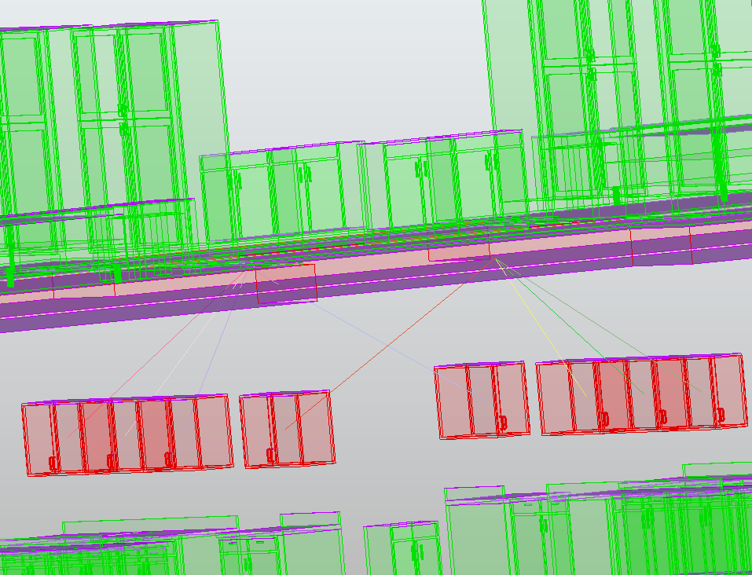

# Description

This rule aims to detect objects that are on top of each other. 

It will first detect, on each object, the face that will be anaylzed. The lateral tolerance may be use to consider more face than the one directly above.
- All faces must point to the top, or bottom.
- The faces must be the highest, or lower, point of the geometry.
	- The faces of an holes point to the top but aren't the highest point of the geometry.

Then it will check the distance between all the faces.

The rule will detect the two faces of the object. Those two faces will be analyze in order to detect if they are in or out.

# Property
A: Object A

B: Object B

Type: 
- MinToMax: The lower part of A will be collided with the highest part of B.
- MinToMin : The lower part of A will be collided with the lowest part of B.
- MaxToMin : The highest part of A will be collided with the lowest part of B.
- MaxToMax : The highest part of A will be collided with the highest part of B.

Tolerance: The maximum distance, in meter, between the extreme faces of A and B for the pair to be considered in contact and analyzed (default: 0.1). The source OBB is also extruded upward by this value to pre-filter the pairs.

The following properties are part of the specification and are not implemented yet:

Min : If the faces of object B is higher than min, it will raise a clash.

Max : if the faces of object B is lower than Max, it will raise a clash.

Lateral_Tolerance: 
By default 0, the lateral tolerance aims to detect that the B object may be offset. 
If the value is negative, it can enforce that the B object is under A object.

# Result

The result will list all pairs of objects (A, B) where B is on top of A: the extreme faces selected by Type are within the Tolerance of each other, and the target face stands above the source face.

A pair whose extreme faces are farther apart than the Tolerance produces no result.

# Example
It can be used to detect if a pipe is right above an electric machine.

## Implementation notes

Conventions left open by this specification, as implemented (class `Above` in Rules.py):

- The extreme faces of each object are the faces visible from the Type direction (bottom faces for Min, top faces for Max); faces of holes are ignored since they are not the extreme point of the geometry.
- A pair is pre-filtered by OBB: the source OBB extruded upward by the Tolerance against the target OBB.
- A pair clashes when the closest points of the two extreme face sets are within 1 mm horizontally of each other with the target above the source (Right_Above), or when a vertical ray cast downward from a closest point of the target face hits a source extreme face.
- The Min / Max bounds and the Lateral_Tolerance are not implemented: the current result carries no distance value.

@todo This function need to be redone. It's slow and it's hard to use opencascade and the triangulation.
