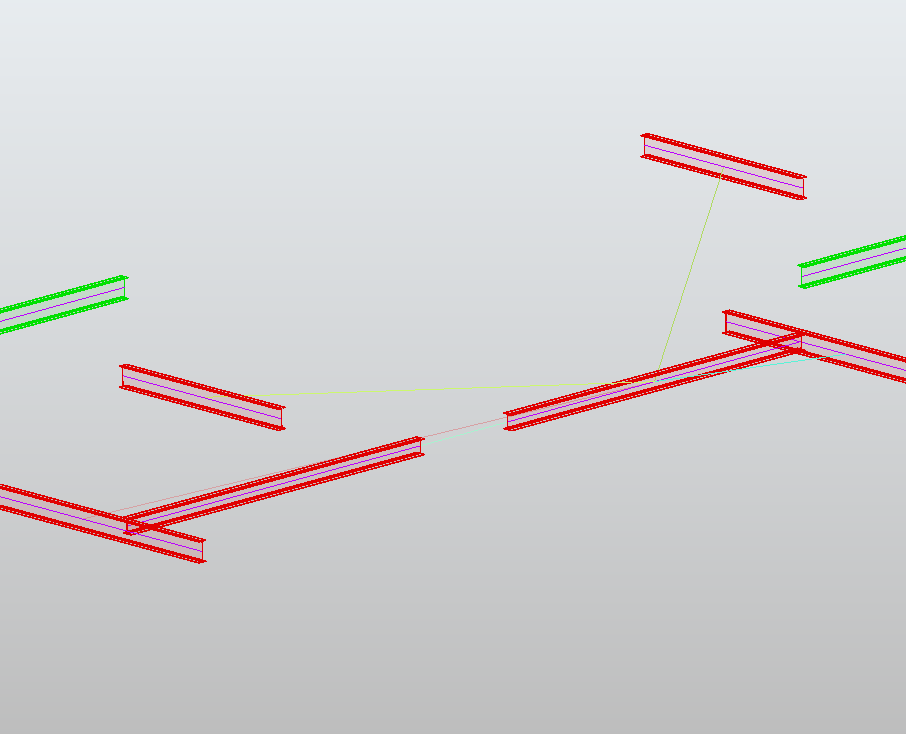

# Description

This rule measures the distance between the axes of two linear objects and validates it against an interval. The axis of an object is the support line of the long dimension of its OBB passing through the centroid, truncated at the OBB extents to form a finite segment.

Usage : réseaux (tuyauteries, gaines, chemins de câbles, tronçons) — les cotes d'exécution et les espacements réglementaires s'expriment en axe-axe (attelage, alignement de pots), pas en espace libre entre peaux. It is the axis counterpart of Clearance, which measures skin to skin: an axis-to-axis rule stays at the regulatory value whatever the couple of diameters, where a skin-to-skin Clearance threshold should be recomputed per Ø/Ø pair.

The rule produces a scalar (the measured distance), not a binary: the result feeds the gravity sorting, the quantitative Must checks and the exceptions. The interval [min, max] detects "too close" as well as "too far" (coverage holes).

Limitation: the directional condition (parallelism) is not tested here. It combines by AND with AngleBetween, notably as an exception, to produce a full coaxiality (parallel axes AND merged axes).

## Algorithm

1. Compute the OBB of each object (method of the project).
2. Extract the axis of each object: the largest dimension of the OBB passing through the centroid, truncated at the OBB extents to form a finite segment.
3. Check the linearity of each object (OBB length / thickness ratio >= `Linearity_Ratio`, thickness = second largest OBB size). A non-linear object (an L-shaped elbow) is not measured axis to axis: the pair is skipped (`On_Non_Linear` = `Skip`) or falls back to the classical skin-to-skin distance (`On_Non_Linear` = `Fallback`), the result then carries the degraded flag.
4. Measure the axis-to-axis distance, in one of the two modes:
   - mode `Perpendicular` (a): the perpendicular offset between the support lines, for objects running side by side (attelage). The offset is only meaningful for quasi-parallel axes (`Axis_Angle` <= `Parallel_Tolerance`); a non-parallel pair automatically falls back to mode (b).
   - mode `MinDistance` (b): always the minimum distance between the two finite segments (analytic), which covers the lateral misalignment of a connection and the end-to-end gap of two runs butted end to end.
5. Compare the measured scalar to the interval [`Min_Distance`, `Max_Distance`] widened by `Tolerance`.
6. Output: the pair when the distance leaves the interval, with the measured value as an attribute (the distance feeds the criticity and the Must checks).

# Property

Source: Object A - the first linear object. The rule is symmetric: Source and Target play the same role.

Target: Object B - the second linear object.

Mode: the measurement mode (type: string, default: `Perpendicular`):
- `Perpendicular`: the perpendicular offset between the support lines of two objects running side by side; non-parallel pairs automatically fall back to the minimum distance between segments (the offset is meaningless for converging lines).
- `MinDistance`: always the minimum distance between the finite segments, whatever the angle of the axes.

Min_Distance: the lower bound of the valid axis-to-axis distance interval, in meter (type: float, optional, default: no lower bound). A measured distance below `Min_Distance - Tolerance` clashes ("too close").

Max_Distance: the upper bound of the interval, in meter (type: float, optional, default: no upper bound). A measured distance above `Max_Distance + Tolerance` clashes ("too far", coverage hole). At least one of `Min_Distance` / `Max_Distance` must be set.

Tolerance: the widening of the interval bounds, in meter (type: float, default: 0).

Linearity_Ratio: the minimum OBB length / thickness ratio for an object to be linear (type: float, default: 10). The thickness is the second largest OBB size. An object below the ratio (an elbow, a compact piece) is not measured axis to axis.

On_Non_Linear: the behavior on a pair containing a non-linear object (type: string, default: `Skip`):
- `Skip`: the pair is left out, no result.
- `Fallback`: the pair is measured with the classical skin-to-skin distance and validated against the same interval; the result carries the degraded flag (`axis_degraded = True`), the measurement is signaled as degraded.

Parallel_Tolerance: the maximum angle between the axes for the Perpendicular mode to apply, in degrees (type: float, default: 1.0). Above it, the pair is measured with the minimum distance between segments.

# Result

For each pair whose axis-to-axis distance leaves the interval, one result containing:
- distance_between: the measured axis-to-axis distance (m), the scalar that feeds the criticity sorting, the quantitative Must checks and the exceptions.
- axis_mode: the measurement actually used (`Perpendicular`, `MinDistance` or `Fallback`), since the Perpendicular mode falls back to the segments on non-parallel axes.
- axis_degraded: True when the pair was measured skin to skin (non-linear object, `Fallback`), the measurement is not an axis-to-axis one.
- axis_angle: the angle between the two axes (degrees).

# Example

The pipes of a bundle laid on a cable tray must be spaced 15 cm axis-to-axis ± 1 cm, whatever the couple of diameters: Source = pipes, Target = pipes, Mode = `Perpendicular`, Min_Distance = 0.14, Max_Distance = 0.16.

Coaxiality of a connection: two pipe runs butted end to end must have an axis distance below 5 mm, combined by exception with AngleBetween (angle <= 0.5 degree) — the good connections are left out, the misaligned ones come out with the offset value for the criticity: Mode = `MinDistance`, Max_Distance = 0.005.

Every reservation crossing a slab must be coaxial with the vertical duct it receives: axis distance below 1 cm over the full height: Mode = `MinDistance`, Max_Distance = 0.01.

## Implementation notes

Conventions left open by the proposal, as implemented (2026-10-13):

- The axis of an object is the primitive shared with AngleBetween (largest OBB dimension through the centroid): the two rules impose the same axis definition, so a full coaxiality combines coherently.
- The segment of an object is truncated at the OBB extents (center ± half length along the axis): for a straight run, the segment spans the object; the linearity ratio guards the bent or compact shapes for which this approximation would drift.
- The axes are unsigned: parallel and anti-parallel axes both give an angle of 0 degree, the direction sign of the OBB axis carries no meaning.
- The offset of the Perpendicular mode uses the bisector of the two axis directions as the common direction, so the offset stays meaningful for slightly converging axes.
- The pair of a selection with itself skips the identity pair (an object is not compared to itself), like the other two-object rules.
- The skin-to-skin fallback (BRepExtrema between the two shapes) validates against the same interval: the degraded measurement is a distance between skins, not between axes, flagged so the result can be told apart in the post-processing.

## Consolidation remarks

- This sheet assumes the "parametrable measure point" engine (skin / axis / centroid) evoked previously: the day an axis-to-skin mode is implemented, it will cover the sprinkler/wall case (the dimension from the axis of the diffuser to the skin of the wall) without new development — only this sheet gains a documented mode.
- Catalog consistency: AngleBetween references its axes by "chosen OBB axis"; this rule imposes the same axis definition (largest OBB dimension x centroid). Raising this axis definition into the shared primitives of linear objects, like the OBB, would fix the semantics once and for all, in the standardization spirit of the project.
