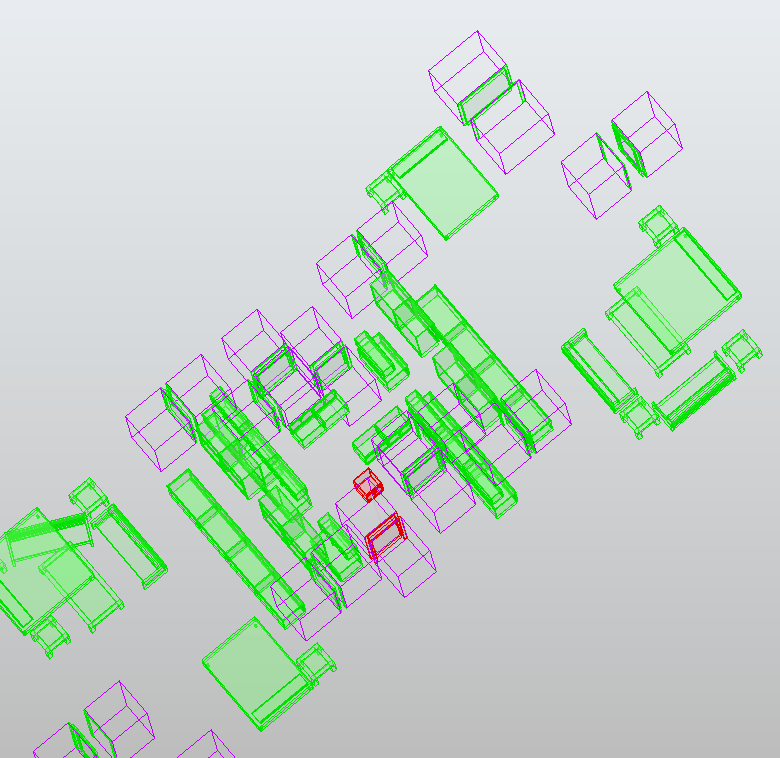

# Description

This rule check for object next to. The object can be above or below but not on the same level.

First, we will get the max 

# Property
source: The source object
target: The target object

Type: 
- MinToMax: ??
- MinToMin : Search the shortest distance between the two objects.
- MaxToMin : ??
- MaxToMax : Search the biggest distance between the two objects

- min
- max 

-Top_Tolerance: By default 0, it allows for the target object to be a little bit above the source object.
-Bottom_Tolerance: By default 0, it allows the target object to be a little bit below the source object.

# Result

# Example

