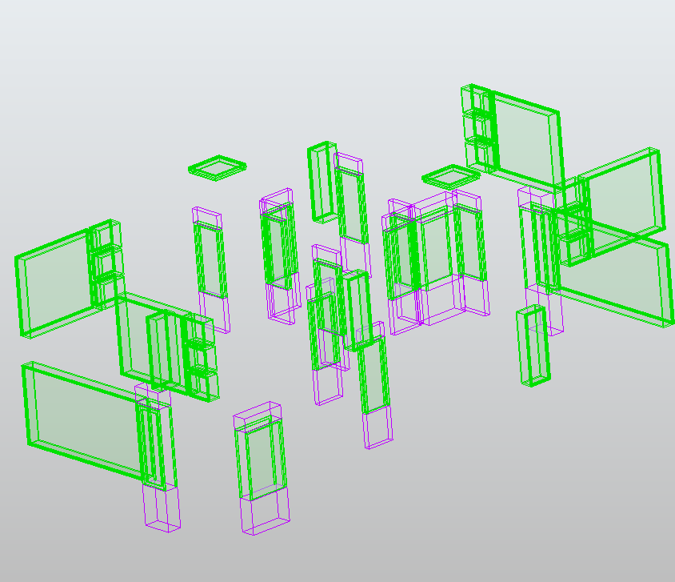

# Description

This rule aims to detect objects that intersect custom detection zones built from the source objects using Oriented Bounding Boxes (OBB).

It creates an OBB for each source object, then applies a list of modifications to that OBB. Each modification transforms the current OBB (expand it, extend it, or detach a new zone next to it), and the keyword NEW_OBB closes the current detection zone and starts a new one from the original source OBB. This allows building several detection zones per source object (for example one above and one below).

Each detection zone is turned into a solid, and the rule checks if any target object touches or intersects one of these zones. A target object that is entirely inside a zone also counts as a clash, since the distance to the zone is then 0.

# Property

Source: Object A - The objects from which the detection zones are built.

Target: Object B - The objects to be checked against the detection zones.

List of Modifications: The ordered list of modifications applied to the source OBB. Each modification is a string of the form "name:value". The value is a distance in the model units, or a percentage of the corresponding OBB dimension when suffixed with "%" (for example "10%"). The modifications are applied in order:
- **expand_sides:X** - Grows the OBB on its X and Y axes.
- **detach_top_by_extrude:X** - Creates a new zone detached from the top of the OBB, touching it but not overlapping it. The height of the zone is X.
- **detach_bottom_by_extrude:X** - Same as detach_top_by_extrude, but below the OBB.
- **extend_up:X** - Extends the OBB itself upward, along the world vertical direction. Works even if the object is tilted.
- **extend_down:X** - Same as extend_up, but downward.
- **NEW_OBB** - Saves the current OBB as a finished detection zone and restarts from the original OBB of the source object.

# Result

The result will list all pairs of objects where a target object touches or intersects one of the detection zones built around a source object.

# Example

It can be used to check the free space above and below equipment: two zones of 10% of the object height can be created above and below each source object with ["detach_top_by_extrude:10%", "NEW_OBB", "detach_bottom_by_extrude:10%"], and any target object found in those zones is reported.
