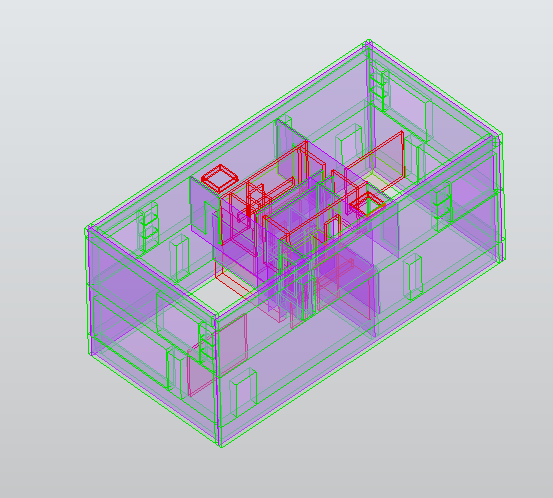

# Description

This rule checks that the objects of a set are aligned: each object must belong to an alignment group, and an object that no valid group takes in raises a clash.

Usage : vérifier l'alignement vertical de poteaux empilés sur plusieurs étages (même axe), l'alignement horizontal des poteaux d'un même étage (une file), ou l'alignement de murs d'une même façade (décalage maximum de 1 m par exemple).



## Algorithm

1. Compute the main axis of the OBB of each source object: the alignment is tested on axes, not on points.
2. Determine the orientation of the objects from `Axis`, or auto-detect it from the dominant axis of the set.
3. Search the alignment groups of the set: a group gathers the objects lying on one common line (least squares on the group). An object may belong to several groups. The candidate lines are seeded by the pairs of objects:
    - `Vertical` (columns): each axis is projected onto the horizontal plane, giving one point per object (the projection of a vertical axis carries no direction). The candidate line of a pair of distinct points is the line through them; stacked columns give coincident points, which form a group on their own (aligned whatever the direction).
    - `Horizontal` (walls, beams): the axes are compared in 3D, according to `Alignment_Type`:
        - `Line`: the axes must be collinear, on one common line (segments continuing on the same axis). The candidate line of a pair of parallel axes is fitted on the endpoints of their axis segments.
        - `Plane`: the axes must lie in one common fitted plane, roughly parallel to it (slabs of a floor, walls of a storey). The fitted plane of a group is free but close to the horizontal (at most 40 degrees from it): a horizontal set of slabs aligns in its floor plane, a ramp in its inclined plane, but a steep plane threads objects of different levels, whatever the tolerance — the alignment of horizontal objects is about levels, and a stack of objects on the same plan line across the levels belongs to the `Vertical` (plan projection) alignment. The candidate plane of a pair of parallel axes apart is their common plane; two parallel axes on the same line (within `Tolerance`) seed the common line instead.
    - The members of a candidate line are the objects within `Tolerance` of it (limit inclusive) whose axis is parallel to the line (a point projection imposes no direction). The two seeds of the candidate line must be strictly within the `Tolerance`.
4. A group with at least `Min_Group` members is a valid alignment.
5. An object belonging to at least one valid group does not raise a clash; an object belonging to none raises a clash.
6. A single global element is still fitted on the whole set (least squares), only to report the `offset` of each clashing object: a guidance value for the correction, not the group decision.

# Property

Source: Object A - the set of objects to check. There is no Target: the rule works on a single set.

Axis: the orientation of the object axes (type: string, default: auto-detected from the dominant axis of the set):
- `Vertical`: the objects stand vertical (columns). Their plan projections must be aligned, on one common line.
- `Horizontal`: the objects lie horizontally (walls, beams). See `Alignment_Type`.

Alignment_Type: the alignment of horizontal axes (type: string, default: `Plane`). Ignored when the axes are vertical:
- `Line`: the axes must be collinear.
- `Plane`: the axes must lie in one common plane.

Tolerance: the maximum offset of an object (as defined in the algorithm), in meter (type: float, mandatory). An object farther than Tolerance is outside the group.

Min_Group: the minimum number of objects in the alignment for it to be valid (type: int, default: 3).

## Template

```
{
    "Source": [],
    "axis": null,
    "alignment_type": "Plane",
    "tolerance": null,
    "min_group": 3
}
```

# Result

- the alignment found: the largest valid group, its fitted line or plane (direction and position) and its member objects. When no valid group exists, the global least-squares fit is reported with the objects within the Tolerance.
- for each object outside every valid alignment: its offset to the global fit, in order to guide the correction.

# Example

Columns stacked across storeys must share the same vertical axis: Source = columns of all storeys, Axis = Vertical, Tolerance = 0.10, Min_Group = 3. A column offset in plan by more than 10 cm from the axis of the others raises a clash.

Columns of one storey must form a clean row: Source = columns of a storey, Axis = Vertical, Tolerance = 0.10. The plan projections of the column axes must lie on one common line; two columns alone always align, hence Min_Group = 3.

Facade walls must be aligned within 1 m: Source = facade walls, Axis = Horizontal, Alignment_Type = Plane, Tolerance = 1.0. A wall joins the group of the facade when its center stays within 1 m of the plan line of a seed pair of the facade.

Wall segments must continue on the same axis: Source = walls, Axis = Horizontal, Alignment_Type = Line, Tolerance = 0.10.

## Implementation notes

Conventions left open by this specification, as implemented (2026-10-12):

- The rule is a one-object rule (`RuleCheckOneObject`): the source is a single set, there is no target, each clash result carries one source object. Its `offset` attribute gives the deviation to the global fit.
- The groups are discovered by `clash_utils.plan_alignment_groups` (Vertical), `clash_utils.coplanar_alignment_groups` (Horizontal, Plane) and `clash_utils.collinear_alignment_groups` (Horizontal, Line), seeded by the pairs of objects: see the algorithm above.
- "Least squares" is a total least squares fit (principal component) on the perpendicular offsets.
- `Alignment_Type = Plane`: the fitted plane of a group is free (least squares on the axis segments of the group). The offset of an object to the global fit is the largest distance of its axis segment endpoints to the fitted plane.
- `Alignment_Type = Line`: the fitted line is adjusted on the endpoints of the axis segments; the offset of an object is the largest distance of its endpoints to the line (a perpendicular segment crossing the line is detected).
- Auto-detection of `Axis`: each object votes vertical when its main axis is within 45 degrees of the global Z; the majority wins, a tie goes to Vertical.
- The OBB main axis is the OBB axis with the largest half size. A vertical main axis is projected to a point in plan (a wall taller than long joins the alignment groups through its plan position).
- Two axes are parallel when they make less than 15 degrees; an axis is parallel to a fitted plane when it makes less than 15 degrees with it, and a fitted plane is rejected when it makes more than 40 degrees with the horizontal (the absolute Z of its normal stays under cos(40 degrees)): two parallel axes always share a plane, so without this limit any pair of objects at different levels would "align" on their diagonal.
- Boundary values: a member at exactly Tolerance belongs to the group, but the two seeds of a candidate line must be strictly within the Tolerance; a group of exactly Min_Group members is a valid alignment.
- Degenerate sets: an empty set raises no clash; coincident projected points (stacked columns) form a group on their own and give zero offsets; two distinct plan positions are always exactly aligned by the fit through them (hence Min_Group = 3); Min_Group = 1 makes every single object a valid alignment, so nothing clashes.
